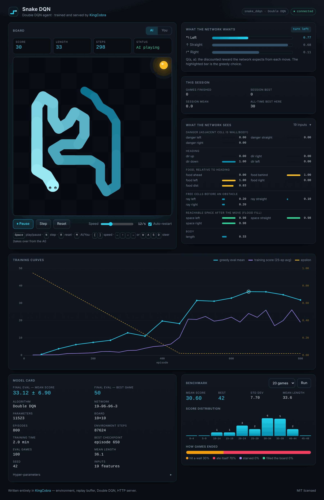

  

All notable changes are listed here. The format follows [Keep a Changelog](https://keepachangelog.com/), and the project uses
[semantic versioning](https://semver.org/).

##  1.0.1

###  Fixes
* **Windows:** the server no longer uses closures (`.map(fn(x) {...})`) on the request path; `GET /api/state` crashed the
  interpreter on Windows (access violation) and is now plain loops. Not reproducible on Linux, so verified there only.
* Console output is ASCII-only (the `—` in the banner printed as garbage in `cmd.exe`).
* Benchmark card: the "How games ended" bar was clipped by a CSS class clash.
* Training chart: clean axis ticks (no more "13 / 38" for 12.5 / 37.5) and the axis label no longer overlaps the ticks.
* Phone layout: the "AI playing" status no longer wraps.

###  Docs
* SVG banners, animated icons, an architecture diagram, a results card and terminal pictures (generated by
  `scripts/build_assets.js`), plus real screenshots of the dashboard (captured by `scripts/screenshots.py`).
* A gameplay video (`docs/media/gameplay.mp4`, plus a looping GIF for the README) recorded from the real dashboard by `scripts/record_video.py`.
* `make assets`, `make screenshots` and `make video`.

##  1.0.0

First professional release. This replaces the single-file prototype (`snake_dqn_web.kc` + `snake_dqn_web.html`).

  

###  Agent
* Double DQN with n-step returns, Huber loss, gradient clipping, soft or hard target updates, linear LR decay.
* Fully vectorised learning step (the prototype looped over samples in the interpreter); verified against a
  per-sample reference.
* Optional prioritised replay (sum tree) with importance-sampling weights.
* Richer, egocentric state: 19 inputs including free-ray lengths and flood-fill reachable space.
* Correct environment rules (tail-cell rule, real "board full" win, starvation limit) instead of treating the tail as a wall.
* Periodic greedy evaluation, best-checkpoint selection, final 100-game measurement, model card and learning curves.
* Single seed controls everything; runs are bit-reproducible.

###  Dashboard and server
* Rewritten front-end: animated canvas, Q-value bars, input inspector, training curves, model card, benchmark.
* Per-session games, strict security headers, validated input, opt-in shutdown, structured request log.
* Updated for KingCobra 1.0 semantics (`var` for reassigned variables; the prototype no longer ran there).

###  Project
* Modular `src/`, JSON config with validation and `--set` overrides, CLI (`train eval watch serve info`).
* 48 KingCobra tests, Node tests for the front-end, Makefile, CI workflow, documentation.
