<p align="center">
  
</p>

<p align="center">
  <a href="#quick-start"> Quick start</a> &nbsp;·&nbsp;
  <a href="#the-dashboard"> Dashboard</a> &nbsp;·&nbsp;
  <a href="#training"> Training</a> &nbsp;·&nbsp;
  <a href="#how-it-works"> How it works</a> &nbsp;·&nbsp;
  <a href="docs/API.md"> API</a> &nbsp;·&nbsp;
  <a href="CONTRIBUTING.md"> Contributing</a> &nbsp;·&nbsp;
  <a href="CHANGELOG.md"> Changelog</a>
</p>

<p align="center">
  
</p>

A **Double DQN** agent that learns to play Snake — environment, replay buffer, neural-network training, HTTP server and a
live web dashboard, all written in [KingCobra](https://github.com/DivyanshuSinha136/KingCobra) using only its standard
library (`std.nn`, `std.http`, `std.json`, `std.system`). No Python, no external dependencies.

<p align="center">
  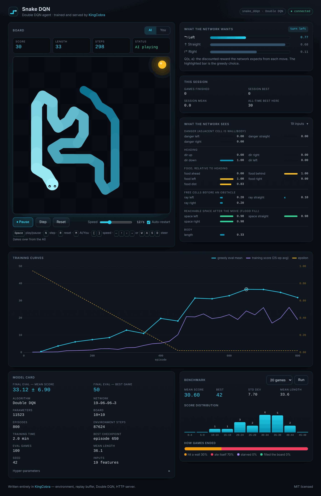
  <br><sub>The dashboard, captured from the real app: the trained agent playing, what it sees and wants, and how it learned.</sub>
</p>

| | |
|---|---|
| **Result** | mean score **33.1** (best game **50**) over 100 greedy games on a 10×10 board after a 2-minute CPU training run |
| **Agent** | Double DQN · 3-step returns · Huber loss · gradient clipping · soft target updates · optional prioritized replay |
| **Network** | 19 → 96 → 96 → 3 (11,523 parameters) |
| **Dashboard** | watch the AI, take over and play, see its Q-values and inputs live, training curves, one-click benchmark |
| **Reproducible** | one seed controls everything; two runs with the same seed give bit-identical models |

<p align="center"></p>

##  Watch it play

<p align="center">
  <a href="docs/media/gameplay.mp4">
    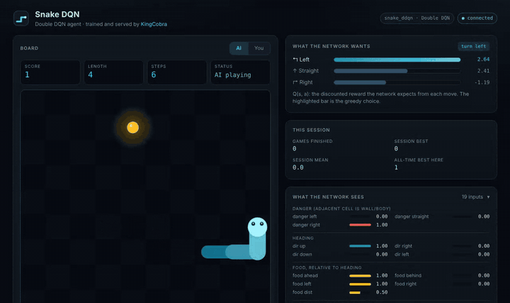
  </a>
  <br><sub>28 seconds, recorded from the real dashboard: the AI plays, a human takes over, the AI resumes.
  <a href="docs/media/gameplay.mp4">Full-quality MP4</a> (1.2 MB).</sub>
</p>

<p align="center"></p>

##  Quick start

Requires KingCobra 1.0 (`kingcobra` on your `PATH`) — and `node` only for the front-end tests.

```sh
git clone https://github.com/DivyanshuSinha136/kingcobra-snake-dqn
cd kingcobra-snake-dqn

make serve            # open http://127.0.0.1:8765  — a pre-trained model is included
make watch            # or watch it play in the terminal
make train            # retrain from scratch (~2 minutes on one CPU core)
make test             # 48 KingCobra tests + front-end tests
```

No `make`? Every target is one command: `kingcobra run src/main.kc <command> [options]`.

<p align="center"></p>

##  Commands

```
kingcobra run src/main.kc <command> [options]

train    train an agent; writes models/<name>.kcnn, .json (model card) and .metrics.json (curves)
eval     play greedy games with the saved model and print statistics
watch    watch the saved model play in the terminal
serve    serve the web dashboard (trains first if no model exists; --no-train to forbid)
info     print the saved model's card

--config FILE     JSON file overriding config/default.json        --seed N       random seed
--set a.b=value   override any value (repeatable)                  --episodes N   training / evaluation episodes
--out DIR --name NAME   where the model lives                      --port N --host H   server address
```

```sh
kingcobra run src/main.kc train --episodes 400 --seed 7 --set agent.n_step=1 --out runs/a
kingcobra run src/main.kc eval  --out runs/a --episodes 200
kingcobra run src/main.kc serve --out runs/a --port 9000
```

Every tunable lives in [`config/default.json`](config/default.json) and is documented in
[`docs/TRAINING.md`](docs/TRAINING.md). Unknown keys and nonsensical values are rejected with a clear message instead of
silently falling back to a default.

<p align="center"></p>

##  The dashboard

A dependency-free canvas front-end served under a strict Content-Security-Policy. Keyboard: `Space` play/pause · `N` step ·
`R` reset · `M` AI/You · `[` `]` speed · arrows/WASD to steer (takes over from the AI).

<table>
<tr>
<td width="62%" valign="top">
  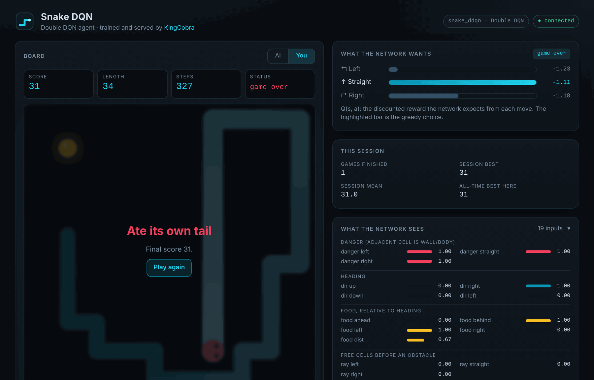
  <br><sub><b>Take over any time.</b> Steer with the arrow keys; the network keeps showing what it would do.</sub>
</td>
<td width="38%" valign="top">
  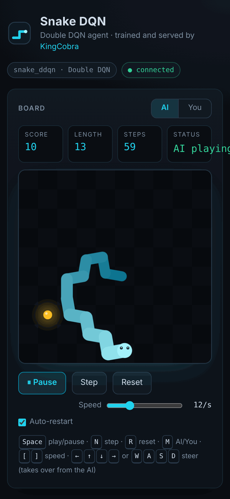
  <br><sub><b>Responsive.</b> Works on a phone.</sub>
</td>
</tr>
</table>

<table>
<tr>
<td width="50%" valign="top">
   <b>What the network wants</b><br>
  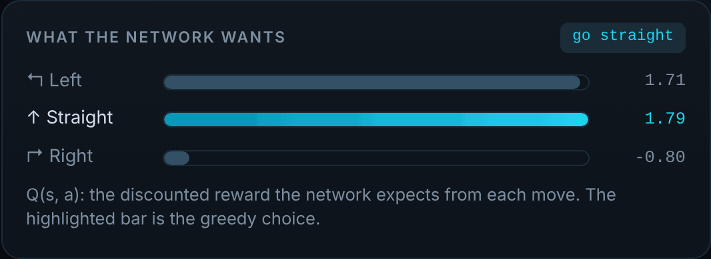
</td>
<td width="50%" valign="top">
   <b>Benchmark</b><br>
  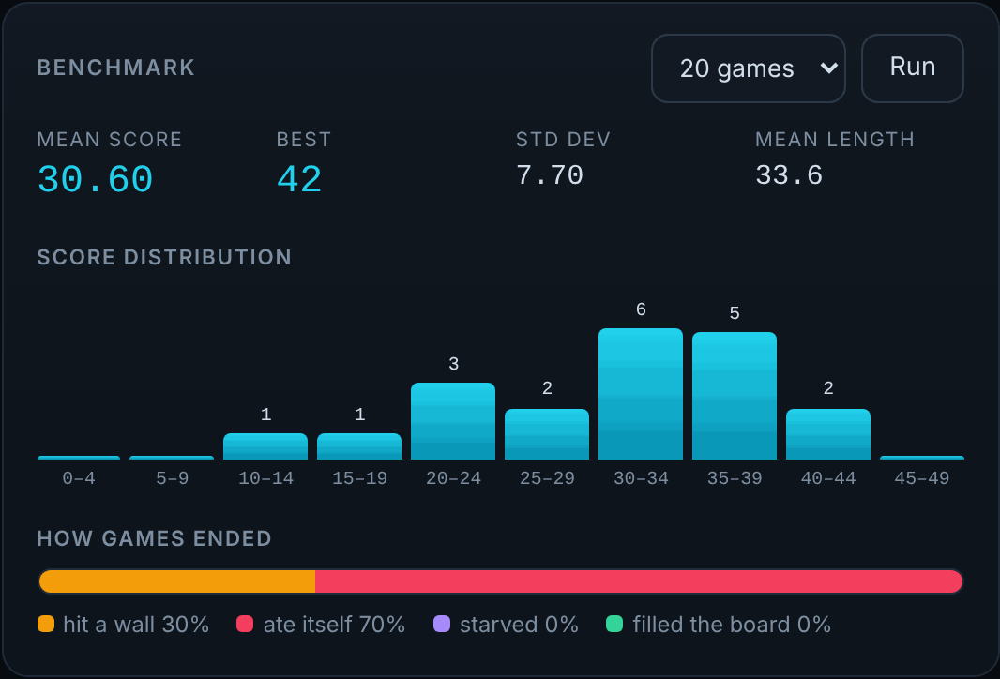
</td>
</tr>
</table>

Smooth snake animation, the network's Q-values for the current state, the 19 inputs it is looking at, training curves
with hover, a model card, and a server-side benchmark with a score histogram and death-cause breakdown.

<p align="center"></p>

##  Training

<p align="center">
  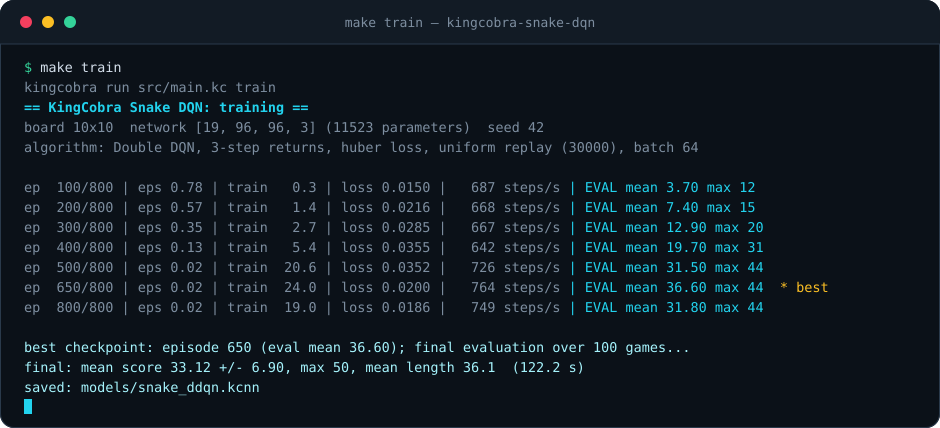
</p>

<p align="center">
  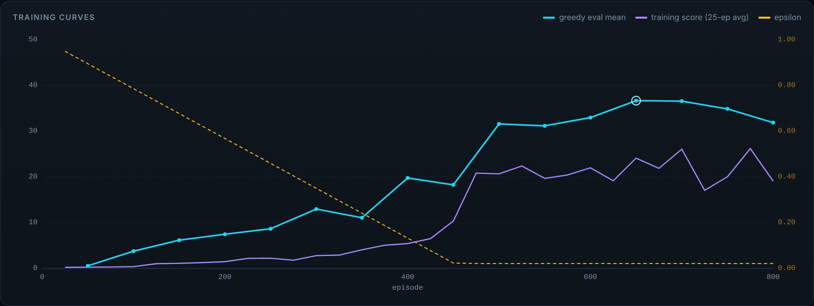
</p>

The greedy evaluation score climbs as epsilon decays; the circled point is the best checkpoint (episode 650), which is the
model that ships. Details, hyper-parameters and an ablation are in [`docs/TRAINING.md`](docs/TRAINING.md).

<p align="center"></p>

##  How it works

<p align="center">
  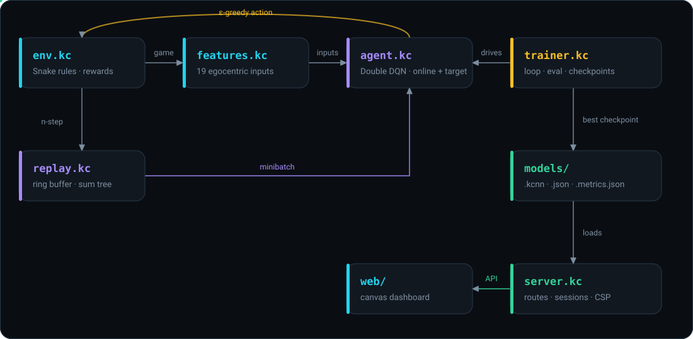
</p>

**State.** Instead of raw pixels, the network sees 19 numbers expressed *relative to the snake's heading* — danger
left/straight/right, where the food is (ahead/behind/left/right), free cells before an obstacle on each side, body
length, and a **flood-fill estimate of the free space reachable after each possible move**. The flood-fill inputs are
what teach the agent not to box itself into a pocket (removing them drops the mean score from 33 to 21; see
[`docs/TRAINING.md`](docs/TRAINING.md)).

**Learning.** For a minibatch of transitions the target of the taken action is

```
y = r_n + γⁿ · (1 − done) · Q_target(s', argmax_a Q_online(s', a))
```

The online network *picks* the next action and the target network *scores* it (Double DQN), which removes the
over-estimation bias of plain DQN. The whole update is a handful of tensor operations — no per-sample loops — so a batch of
64 costs a fraction of a millisecond. The vectorised target is unit-tested against a one-sample-at-a-time reference to 1e-9.

<p align="center"></p>

##  Project layout

```
src/
  main.kc        CLI (train · eval · watch · serve · info)
  config.kc      defaults, JSON overlay, --set overrides, validation
  env.kc         Snake rules, rewards, ASCII renderer
  features.kc    state encoder (+ flood fill)
  replay.kc      circular buffer, optional prioritised sampling (sum tree)
  agent.kc       Double DQN: networks, vectorised learning step, save/load
  trainer.kc     training loop, evaluation, checkpointing, metrics
  server.kc      routing, sessions, security headers, static assets
  util.kc        RNG, statistics, helpers
web/             index.html · style.css · app.js · favicon.svg
config/          default.json
models/          pre-trained snake_ddqn.kcnn + model card + curves
scripts/         build_assets.js (SVGs) · screenshots.py · record_video.py · test_web.sh
tests/           KingCobra tests (env, features, replay, agent, trainer, config, server) and tests/web/ (Node)
docs/            ARCHITECTURE.md · TRAINING.md · API.md · img/ (banners, icons, screenshots, gif) · media/ (gameplay.mp4)
```

<p align="center"></p>

##  HTTP API

`GET /api/state` · `POST /api/reset` · `POST /api/ai-step` · `POST /api/human` · `GET /api/model` ·
`GET /api/metrics` · `GET /api/benchmark?episodes=N` · `GET /api/health`. Games are per-session (`?sid=`), so several
browser tabs never share a board. Full reference: [`docs/API.md`](docs/API.md).

<p align="center"></p>

##  Testing

<p align="center">
  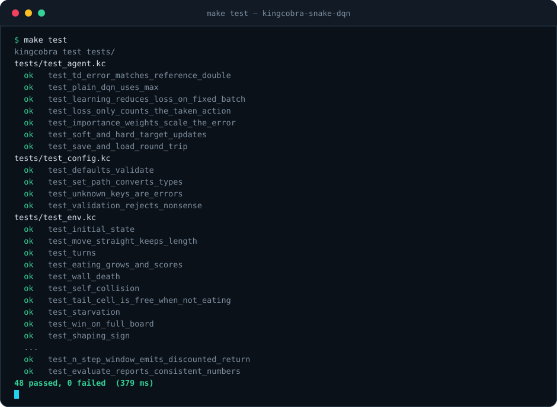
</p>

`make test` runs 48 KingCobra tests — game rules (including the tail-cell rule and a perfect-game win), feature semantics
and rotation-equivariance, the sum tree and importance weights, the Double-DQN target against a reference, exact save/load
round-trips, determinism of whole training runs, and the real server booted as a child process and driven over HTTP — plus
unit tests for the front-end's pure functions and a smoke test that runs the real `app.js` against a live server with a stub DOM.

<p align="center"></p>

##  Limitations

* The server is single-threaded: a benchmark request blocks other requests for its duration (capped at 50 games).
* Training runs on the KingCobra interpreter, on the CPU (about 700 environment steps per second including learning).
* The shipped numbers come from one seed; differences of a few points between algorithm variants are within run-to-run
  noise (see the ablation notes in `docs/TRAINING.md`).
* Boards other than 10×10 work (`env.size`) but need their own training run; the shipped model is for 10×10.

<p align="center"></p>

##  License

[MIT](LICENSE) © 2026 Divyanshu Sinha
