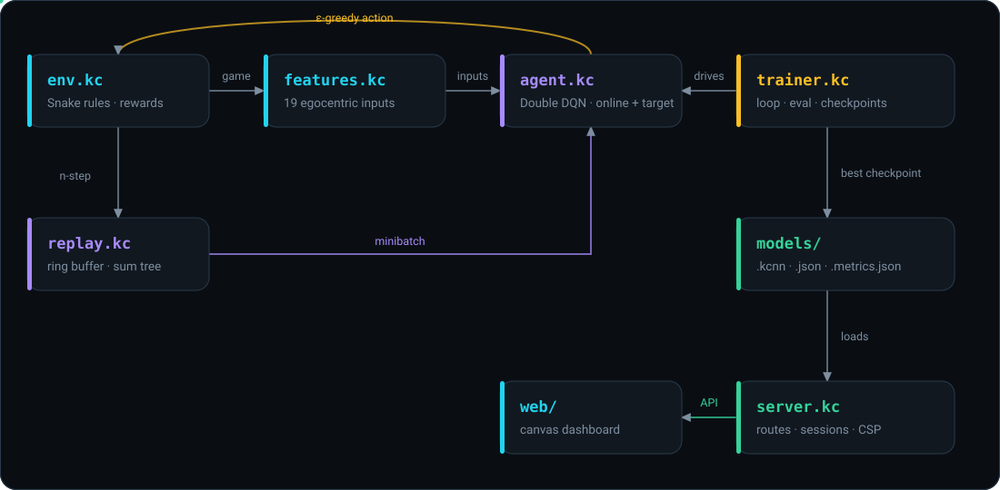

# Architecture

  

## Modules and responsibilities

| Module | Depends on | Responsibility |
|---|---|---|
| `util.kc` | `std.nn`, `std.system` | RNG through `nn`'s generator, statistics, formatting, `fail()` |
| `env.kc` | `util` | game state as a plain object; `step` returns the reward and sets `done`/`cause` |
| `features.kc` | `env` | 19-input egocentric encoding with flood fill |
| `replay.kc` | `util` | ring buffer + sum tree; knows nothing about networks |
| `agent.kc` | `env`, `util`, `std.nn` | networks, optimiser, vectorised Double-DQN update, save/load |
| `trainer.kc` | all of the above | episodes, n-step assembly, evaluation, checkpoints, metrics |
| `config.kc` | `std.json`, `util` | defaults → JSON file → `--set`, validation |
| `server.kc` | `trainer`, `agent`, … | routing as a pure function, sessions, static assets |
| `main.kc` | everything | argument parsing and command dispatch |

The environment has no idea a learner exists, and the agent has no idea what Snake is (it only knows the input
dimension and 3 actions). That is what lets the server, the tests and the trainer all reuse the same `env.step`.

## Design decisions

**Games are plain objects, modules are stateless.** In KingCobra every `import` of a file creates its own module
instance, so a module-level `var` is *not* shared between importers. All shared state (games, replay buffers, agents,
sessions) therefore travels as objects passed explicitly. A side benefit: every function is trivially testable.

**One RNG.** Everything random — weight initialisation, exploration, food placement, replay sampling — draws from
`nn`'s generator, so `nn.seed(n)` reproduces a run exactly. `tests/test_trainer.kc` checks that two runs with the same
seed produce byte-identical model files.

**Vectorised learning step.** KingCobra is interpreted, so per-sample loops in the update are the bottleneck. The
update builds the targets with tensor ops only (`argmax`, `gather`, one-hot masks), freeing every temporary
explicitly because the language has no garbage collector. The same code path is verified against a per-sample
reference.

**Tail-cell rule.** The head may move into the cell the tail is leaving (as in the real game) unless it eats. The
environment, the danger features and the flood fill all use the same `env.blocked`, so the agent's view of the world
can never disagree with the rules.

**Routing is a function.** `server.route(ctx, req)` returns a response object; only `server.run` touches sockets.
Tests drive the real server over HTTP, but `route` can also be called directly.

**Atomic writes.** Metrics and model cards are written to a temp file and renamed, so a dashboard polling during
training never reads half a file. The network file format is CRC-protected by `std.nn`.

## Extending

* **A different board or rewards** — edit `config/default.json` (or `--set`); retrain.
* **New input features** — add them in `features.kc`, update `NAMES` and `DIM`, and the dashboard's inspector picks the
  new names up from the model card automatically. Old models are incompatible (input size) and must be retrained.
* **A different agent** — anything exposing `create / q_values / act / learn / save / load` with the same shapes can
  replace `agent.kc`.
