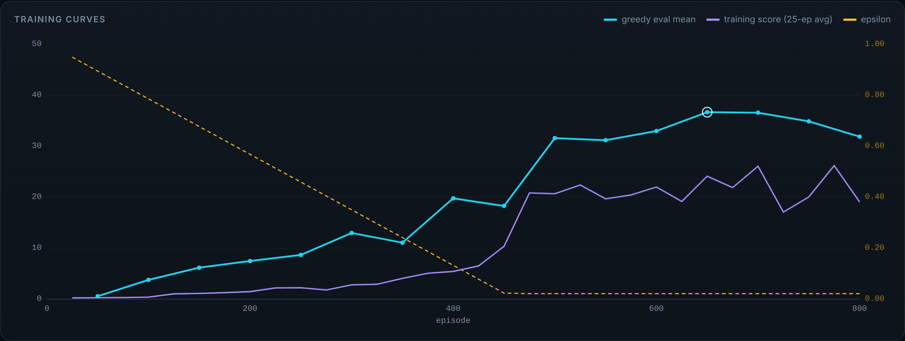

# Training guide

## Algorithm

Standard DQN with these ingredients, each switchable from the config:

| Ingredient | Setting | Notes |
|---|---|---|
| Double DQN | `agent.double` | online net chooses `argmax`, target net evaluates it; `false` gives plain DQN |
| n-step returns | `agent.n_step` | rewards are summed over `n` steps and discounted by `γⁿ`; the tail of every episode is flushed with the right shorter discount |
| Huber loss | `agent.loss`, `agent.huber_delta` | robust to the occasional large TD error (death = −1, win = +5) |
| Gradient clipping | `agent.clip_norm` | global L2 norm; `null` disables |
| Soft target update | `agent.target_tau` | Polyak averaging every update; set `agent.target_hard_every > 0` for periodic hard copies instead |
| Prioritised replay | `replay.prioritized`, `replay.alpha`, `replay.beta_start` | proportional sampling through a sum tree, β annealed to 1 |
| LR schedule | `agent.lr` → `agent.lr_final` | linear over the run |
| ε-greedy | `train.eps_start/eps_end/eps_decay_episodes` | linear decay per episode |

**Terminal handling.** Hitting a wall, the body or starving are terminal (no bootstrap). A step-limit *timeout* is not
a real terminal state, so it still bootstraps.

**Importance-sampling weights.** `std.nn` losses take no per-sample weights. Scaling the *error* by `w` scales an
MSE gradient by exactly `w`, so the agent regresses onto `q + w·(y − q)` instead of `y`. For Huber loss this is a close
approximation (the clipping happens after scaling). Importance weights are only used with `replay.prioritized`.

## Reward design

| Event | Reward (`reward.*`) |
|---|---|
| eat food | +1.0 (`food`) |
| every step | −0.01 (`step`) |
| step closer to / farther from the food | ± 0.03 (`shaping`) |
| die (wall or body) | −1.0 (`death`) |
| starve (too many steps without food: `env.idle_base + env.idle_per_len · length`) | −0.5 (`starve`) |
| fill the board | +5.0 (`win`) |

Shaping is small on purpose; it speeds up early learning without outweighing the food reward.

## Hyper-parameters (defaults)

| Key | Default | Meaning |
|---|---|---|
| `seed` | 42 | seeds *all* randomness |
| `env.size` | 10 | board side |
| `agent.hidden` | [96, 96] | hidden layers |
| `agent.lr` / `lr_final` | 0.001 / 0.0002 | Adam learning rate, linearly decayed |
| `agent.gamma` | 0.95 | discount |
| `agent.n_step` | 3 | return horizon |
| `agent.target_tau` | 0.01 | soft target rate |
| `replay.capacity` / `batch` / `warmup` | 30000 / 64 / 1000 | |
| `train.episodes` | 800 | |
| `train.eps_start → eps_end` over `eps_decay_episodes` | 1.0 → 0.02 over 450 | |
| `train.eval_every` / `eval_episodes` | 50 / 10 | greedy evaluation that picks the best checkpoint |
| `train.final_eval_episodes` | 100 | final measurement of the best checkpoint |
| `train.target_score` | null | stop early after two evaluations at or above this mean |

Outputs go to `train.out_dir` (default `models/`): `<name>.kcnn` (best checkpoint, CRC-protected KCNN file),
`<name>.json` (model card), `<name>.metrics.json` (curves for the dashboard).

## Results

  

  

Shipped model — seed 42, default config, 800 episodes (87,624 environment steps, 122 s on one CPU core), best
checkpoint at episode 650, measured over 100 fresh greedy games:

| mean score | std | best game | mean length | died by wall / body |
|---|---|---|---|---|
| 33.1 | 6.9 | 50 | 36.1 | 33 / 67 |

### Ablation (single seed, 100 greedy games each)

| Variant | Mean score | Best |
|---|---|---|
| default (Double DQN, 3-step, uniform replay, flood-fill inputs) | 33.1 | 50 |
| plain DQN (`agent.double=false`) | 32.1 | 50 |
| 1-step returns (`agent.n_step=1`) | 33.8 | 51 |
| prioritised replay (`replay.prioritized=true`) | 30.0 | 50 |
| no flood-fill inputs (`features.flood=false`) | 21.1 | 37 |

How to read this: each row is **one** training run. A single evaluation has a standard error of about 0.7 points, but
training itself varies from seed to seed by more than that, so the first four rows are **not** meaningfully different.
The flood-fill result (−12 points) is large enough to be real. To get tighter comparisons, repeat with several
`--seed` values (`make ablate` reproduces these rows).

## Tips

* More episodes help: the curve is still rising at 800 on some seeds. Try `--episodes 1500`.
* The best checkpoint is chosen from only 10 evaluation games per check; raise `train.eval_episodes` for a less noisy
  choice at the cost of time.
* Changing `env.size` or the feature set requires retraining; models store the architecture, not the environment.
